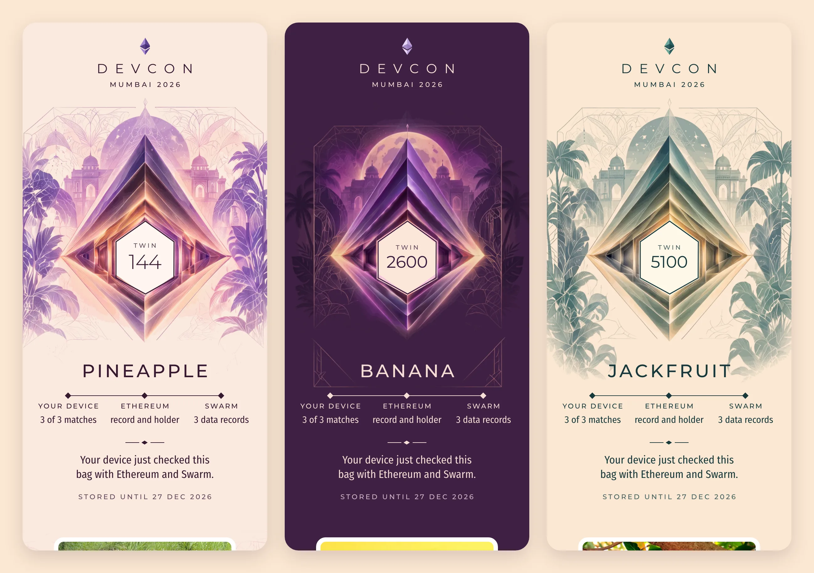
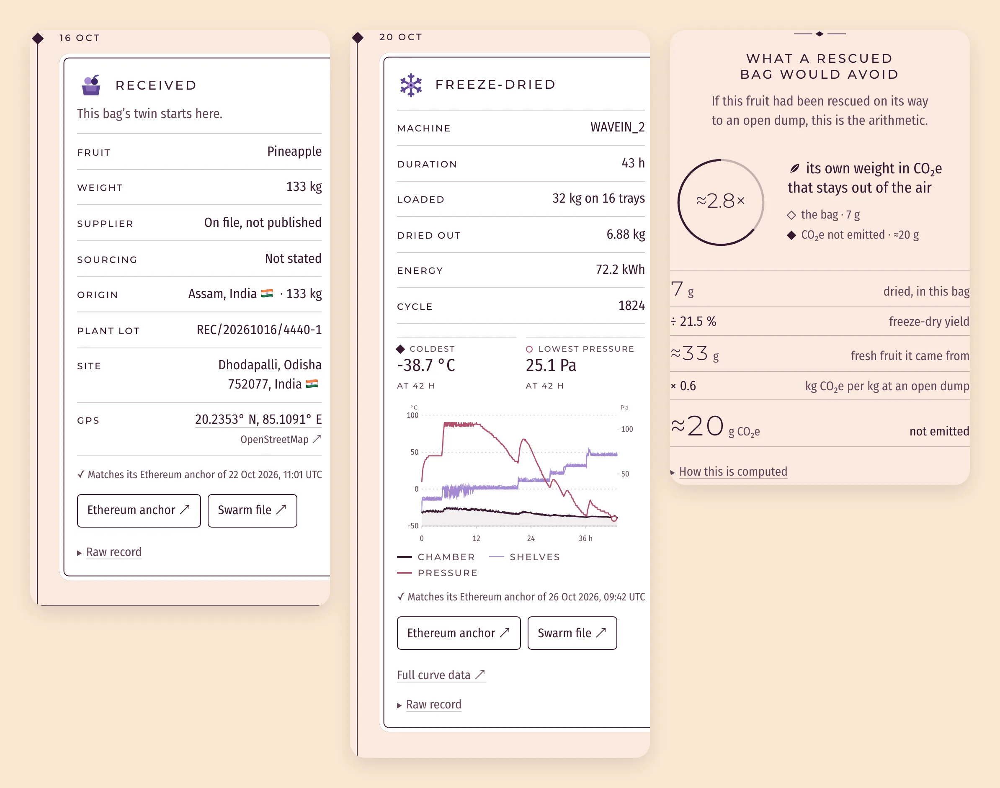

# twin-page

**The page a bag opens.** Scan the QR on a bag of freeze-dried fruit from Devcon 8 and this page reads the bag's records, anchored on Ethereum and stored on Swarm, and checks them on your own device: every record is hashed again and compared with the reference its anchor names. No server of ours sits in between.



One HTML file, nothing else to load. Anyone can read it top to bottom with view source, and every release is published here with its SHA-256. Built for Devcon 8 (Mumbai, 3 to 6 November 2026). The structure is final; the content is not (see [Status](#status)).

**Contents.** [Try it](#try-it) · [The link](#the-link) · [The file](#the-file) · [What the page shows](#what-the-page-shows) · [The check](#the-check) · [The fingerprint](#the-fingerprint) · [Releases](#releases) · [What the page never does](#what-the-page-never-does) · [Build](#build) · [Files](#files) · [Status](#status) · [License](#license)

## Try it

1. Download `devcon8.html` from the folder of the current release, the one marked current in [Releases](#releases) ("Download raw file" on GitHub), and open it in a browser. It needs no server and nothing to install.
2. Add the network, the contract and a bag number after a `#` at the end of the address, and load the page again:

```
devcon8.html#1:0xc7e8Dd10265b5d4A549321411617Dff4DB4ccb8a/144
```

   That is a real bag of pineapple on Ethereum mainnet: bags 1 to 2500 are pineapple, 2501 to 5000 banana, 5001 to 7500 jackfruit. The test bags on Sepolia open too, with `11155111:0x240dfbca7064d091149169eff95f764d1e21cea7` in place of the network and the contract. The page reads Ethereum and Swarm, so it needs an internet connection.
3. What you see, in order: the front of the pouch with its crystal drawn as an outline; a line from your device to Ethereum and on to Swarm, each stretch drawn as its read comes back; the hexagon closing, the pouch taking its colours and the line "Your device just checked this bag with Ethereum and Swarm."; the fruit and what the bag holds; the records of the path; the arithmetic of the CO₂; who holds the twin; and, last, the photograph of the fruit and the art of the pouch.

## The link

The QR on a bag is a link to this page with the bag after a `#`:

```
https://fairfooddata.eth.limo/devcon8.html#<chainId>:<contract>/<id>
```

`chainId` is the network (1 for mainnet, 11155111 for Sepolia), `contract` the address of the Fair Food Data contract and `id` the bag number. The page checks the contract against the ones it lists (`contract` and `contracts` in the configuration); one it does not list is checked, on mainnet, against the `ffd.contract` record of `fairfooddata.eth`. A contract that is not Fair Food Data's shows a warning and nothing else.

## The file

The product is the file. `devcon8.html` is one document of about 360 KB that reads like its source, laid out in six marked parts, each announced by a comment you can find with search:

```
devcon8.html
│
├─ <head>
│   ├─ Content-Security-Policy    the three scripts the file runs, each named by its SHA-256.
│   │                             Nothing written into the page afterwards can run
│   ├─ a map of the file          this list, and what the page talks to
│   └─ two lines of script        the first paint: is there a bag in the link, and does the
│                                 footer keep a row for the fingerprint
│
├─ 1 · Styles      the page's own CSS, in the order of the blocks on screen
├─ 2 · Markup      the front of the bag · the fruit · the path · the arithmetic · the holder · the footer
├─ 3 · Config      JSON: the RPCs by network, the contracts, the Swarm gateways, the stamp, the links,
│                  the CO₂ factors. Nothing about the fruit            (added by the build)
├─ 4 · Library     viem, bundled and minified from npm, unchanged          (added by the build)
├─ 5 · Script      the page's code as written in src/lib.ts, web/life-grid.ts and web/devcon8.ts,
│                  with only the types removed
└─ 6 · Fonts       Montserrat, Fira Sans Condensed and Spline Sans Mono, cut to what the page
                   draws with them, inlined as base64
```

What is not in it: no image, no cookie, no analytics, no address of ours. Of the fruit the file knows only the colours of each pouch. The name, the label, the photograph, the art of the pouch and the places of the path are files the bag's own records name, read from Swarm and checked against their references.

What the page talks to, all of it read only: **Ethereum** (a wallet in the browser if there is one, else the RPCs of the config), **Swarm** (public gateways), **itself** (once more, to show its fingerprint), and the holder's ENS avatar when the twin has moved. OpenStreetMap, Blockscout and Stamptime are links, followed only when tapped.

## What the page shows

Top to bottom, each block filling in as its records arrive. The page opens in ivory and teal and takes the colourway of the bag's pouch once a record that passed the check has named its fruit.



| Block | What it shows | From |
|---|---|---|
| The front | The pouch's crystal with the twin's number in the hexagon, the name of the fruit, and the three reads on one line: your device asks Ethereum, then Swarm, then hashes every record. The hexagon closes when every record matches, with the day the records are paid up to on Swarm under the seal | Ethereum and Swarm |
| The fruit | The back of the pouch: the photograph where the QR sticker sits, and the label: grams per bag, energy, sugars, protein, fat, fibre, and the full table per 100 g | Files named by the packing record |
| The path | One card per record: received, freeze-dried, packed, delivered. Each with its rows, the check against its Ethereum anchor and the anchor's date, links to the anchor and to the file on Swarm, and the raw record. The records write their moments in UTC; the cards show them in the time of where the bag was, the last place the path gives at or before the record, by the zone its file names or the country of its address, and in UTC, said so, until a place has come. Received names the farm and the plant, with a flag and coordinates. Freeze-dried draws the cycle: temperature and pressure hour by hour, the coldest point and the lowest pressure marked. Delivered draws the route from the plant to where the bag went | The records on Swarm, and the files they name |
| The arithmetic | If this fruit was rescued: the grams in the bag, the fresh fruit they came from and the CO₂e that stays out of the air, every assumption in view | The records and the factors in the config |
| The twin | Who holds it: the jazzicon of the address, or its ENS name and avatar | Ethereum and ENS |
| The footer | Anchored on Ethereum, stored on Swarm, living on public rails. Three rows of small print: where the code is, the fingerprint of the file, and the contract on its explorer | The config |

The states the page handles: no record yet for the bag; no bag in the link, or one cut short (the page opens on how it works and reads no network); a contract it does not list; a network it has no RPC for; a source that does not answer (the next is asked; when none does, Try again); a record that fails the check; a record that passes and is of a kind the page does not know.

A record that fails the check is never read: what a gateway serves is hashed and compared with its anchor before a byte of it is parsed. A record that passes and that the page does not understand gets a card that says so, with its text as it was written, and the rest of the page goes on.

What the page says of the fruit, and where it has been, is not in the page: the packing record names the description, the photograph and the art of the pouch, and the intake and transport records name the two places, each file by name, type and Swarm reference. Each is read like a record, used only when its bytes give that reference, and written as text. A file of another name or type, heavier than 1 MiB, or whose bytes are not what they should be is not shown, and the page is the same without it.

## The check

The records are checked by arithmetic: whatever gateway serves them, their bytes give their reference or they do not. The gateways of the config are asked in order; one that did not answer goes last until Try again.

What Ethereum says is different: which record a bag has, and whether it is anchored, is something the page is told. It reads with the first source that answers:

1. A wallet in the browser, when there is one. It is asked to read, never for an account, a signature or a change of network.
2. The RPCs of the config, in order. For mainnet an Alchemy endpoint and three public ones; for Sepolia the same key and a public one. The key is public, like the rest of the file, and limited to the page's contracts and the domains that serve it.

When every record matches, the next source is asked the same two things. Its answer is kept on the plate (`data-sources`: `agree`, `differ` or `single`). When it differs, one of the two is not telling what is anchored and the page cannot tell which: the plate opens again, the seal goes and a notice says so. When no second source answers, the check is as good as the first.

One more read, on another chain: the records are stored under a Swarm stamp the bag's record names. Once every record has matched, the page asks Swarm's postage contract on Gnosis, through the RPCs of the config and never a wallet, what is left on that stamp. The day that gives is the one under the seal; the day written in the config stands until then and when the stamp cannot be read. Tap it to see the stamp on Stamptime.

## The fingerprint

A page cannot carry its own hash. So when it opens from the web, the device asks whoever served it for the file once more, hashes what it gets and shows the result in the footer. Compare it with `SHA256SUMS` in the folder of the release.

That tells a copy from the published file when nobody is hiding the difference. It is no defence against whoever serves the page: a file changed on purpose shows the number it likes. To be sure of a copy, download it and hash it yourself:

```
cd releases/<folder> && shasum -a 256 -c SHA256SUMS
```

The build is deterministic: with Node 24 and the lockfile it gives the same bytes every time. To check that a published file is what its source builds:

```
git checkout <tag>
npm ci
node scripts/standalone.mjs --release <folder>
shasum -a 256 dist/devcon8.html
```

## Releases

Every published file, in order. A release has a number, a folder that is never written again and a tag on the commit it is built from. The first number is 0 until the first official release, 1.0. The first two folders and tags are dates; from 0.3 on, release n is `releases/n/` and its tag `vn`.

| Release | Date | Folder | Tag | SHA-256 of `devcon8.html` | Status |
|---|---|---|---|---|---|
| 0.1 | 9 Oct 2026 | `releases/2026-10-09/` | `2026-10-09` | `c9840efe1f223e1d199b2f6039be5573bdefd9685378a51631ac4f4f32e2ed87` | withdrawn |
| 0.2 | 10 Oct 2026 | `releases/2026-10-10/` | `2026-10-10` | `0e6f48570feedab7d29b1b6a741eabf1366ea2a4aacd201b3052f54eee69d95e` | superseded |
| 0.3 | 11 Oct 2026 | `releases/0.3/` | `v0.3` | `804395a26c31d6739ecacdd80b0fc210a9f1b5e0e566341f4aee44630428b1fd` | superseded |
| 0.4 | 11 Oct 2026 | `releases/0.4/` | `v0.4` | `df51fe61184360017716f81cee96f6eba8cf3f0bb9e1c1664a563c28fd9ba613` | superseded |
| 0.5 | 1 Nov 2026 | `releases/0.5/` | `v0.5` | `c28d6309cca9dfd5e891e31959b3f3a26f08742614f87a31a43f2e2c0597fe85` | current |

The file to use is the one marked current. Do not use 0.1, withdrawn: it paints a record before checking it, so a gateway or an RPC that lies can run script in it. Its file stays here with its hash so that a copy can be recognised.

To publish the next one: `npm run release -- <n>` builds the file, files it in `releases/<n>/` with its `SHA256SUMS` and adds its row to this table. Commit the folder and the README; once that commit is on `main`, tag it `v<n>` and attach the two files to a GitHub release of that name, marked as a pre-release while the first number is 0.

## What the page never does

- No server of ours. It reads Ethereum and Swarm, and that is all.
- With no bag in the link it reads nothing but its own file, for the fingerprint. Opened from disk, nothing at all.
- No image until everything else is on screen; then the photograph, the cover and the background, each once the one before is in or has failed, each shown only when its bytes give its reference.
- No cookies, nothing kept on the device, nothing signed, uploaded or moved.
- What follows `#` in the link is not sent to whoever serves the page. The source it reads Ethereum with sees the bag; the gateways see which records are fetched.
- No script but its own three, named by hash in the Content-Security-Policy. What a record says is written as text.
- No off-chain lookup (CCIP-Read): a name kept off-chain is not resolved, and its holder is shown by address.
- Never the full curves of a cycle (about 2 MB of SenML): it draws the light file the record names for the page, and the full data opens on Swarm only when tapped.

## Build

```
npm ci
npm run check           # type check
npm test                # the check and the paint functions against a gateway, an RPC and records that lie
npm run dev             # http://localhost:5173/devcon8.html
npm run standalone      # dist/devcon8.html, the one file
npm run release -- <n>  # builds the file and files it as release <n>
uv run scripts/fonts.py # the faces of web/public/fonts/, cut again from their masters in fonts-src/
```

The faces are cut once, when a master changes or the page writes something new in one of them, and the cuts are committed: the build needs neither uv nor the masters.

## Files

| File | What it is |
|---|---|
| `web/devcon8.html` | The page: markup, styles, and the two lines of script in its head |
| `web/devcon8.ts` | The script: the reads, the check, the arrival of every block, the stamp, the curves, the route, the holder, the fingerprint |
| `web/life-grid.ts` | The field behind the footer |
| `src/lib.ts` | The contract's read side, the link format, downloading a record, and the Swarm reference of a file computed the way Swarm computes it |
| `src/rails.ts` | Everything the page takes from viem, by name |
| `web/public/config.json` | What the page reads: RPCs, contracts, gateways, the stamp, the links, the CO₂ assumptions. Nothing about the fruit |
| `web/public/fonts/`, `fonts-src/` | The five faces the page inlines, and the masters they are cut from |
| `scripts/standalone.mjs` | Folds the page into one file and writes the policy that names its three scripts by hash |
| `scripts/release.mjs` | Builds the file and files it as the next release. It never writes over one |
| `scripts/inspect.mjs` | Parses a built file as a browser would: one policy, the scripts it names, nothing else that runs or loads |
| `scripts/fonts.py`, `scripts/plates.py` | Cut the faces from their masters; make the plates of a pouch from its flat art, kept with the packaging. The plates are not part of the page: they go to Swarm with the packing record that names them |
| `test/check.test.mjs` | The whole check against gateways, RPCs and a wallet that lie, fail or do not answer |
| `test/paint.test.mjs` | The paint functions, given records and files whose values are HTML: nothing of it may become an element |
| `test/empty.test.mjs` | The page with no bag in the link: a single request, for its own file |
| `test/fonts.test.mjs`, `test/releases.test.mjs` | The faces against their masters, and every release against its hash and its row |
| `releases/<folder>/` | The published files and their `SHA256SUMS` |

## Status

1 November 2026. Release 0.5, on real records, for Devcon 8 (3 to 6 November).

- The page reads the real records on mainnet, in the contract the QR of every bag names, as far as its packing: no transport is declared on mainnet. The test contract on Sepolia opens too, with a transport on its banana bags.
- Each fruit has a stamp of its own on Swarm. Unless someone adds to them, the three run out on 28 December 2026; the page shows the day of the bag's own stamp when it can read it.
- The nutrition figures are the producer's, given per 5 g serving as ranges; each description declares the middle of each range for 100 g and keeps the ranges as given.
- The CO₂ factor and its reference scenario are placeholders.
- The test records of bags 1 to 20 on Sepolia are of mango and name no file of a product.
- The bags and their packaging are separate work, not in this repository.

## License

Apache 2.0, see `LICENSE`. The code is yours to use, copy and change, with the notices kept.

The name Fair Food Data, its mark and the lockups in `web/public/brand/` are not covered by the license: they identify us, not the code. A copy of the page for another twin takes the code and leaves the mark.

What comes from others keeps its own license: viem (MIT), and the three typefaces, Montserrat, Fira Sans Condensed and Spline Sans Mono (SIL Open Font License 1.1). The photographs of the bananas and the jackfruit are from Unsplash, by Giorgio Trovato and Antonio Castellano. That of the pineapples was taken at their plantation in Assam and given by the grower.
